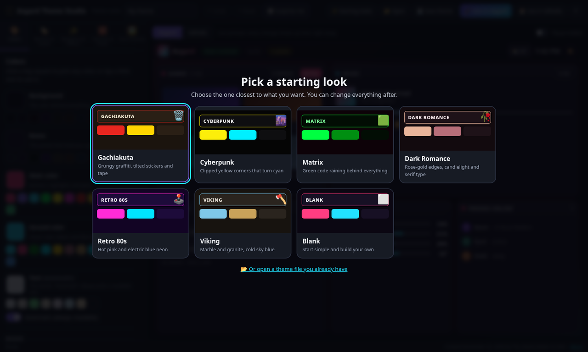
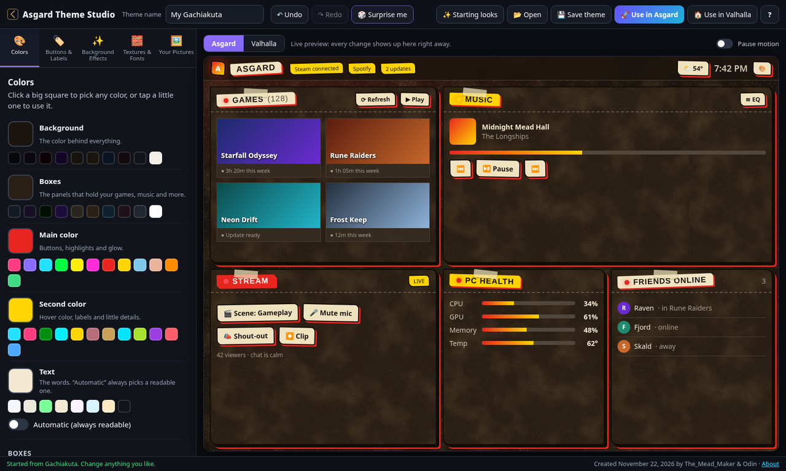
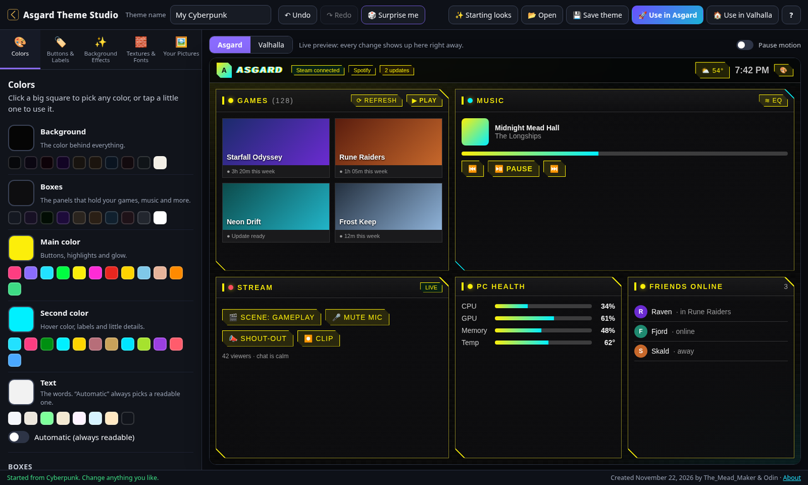
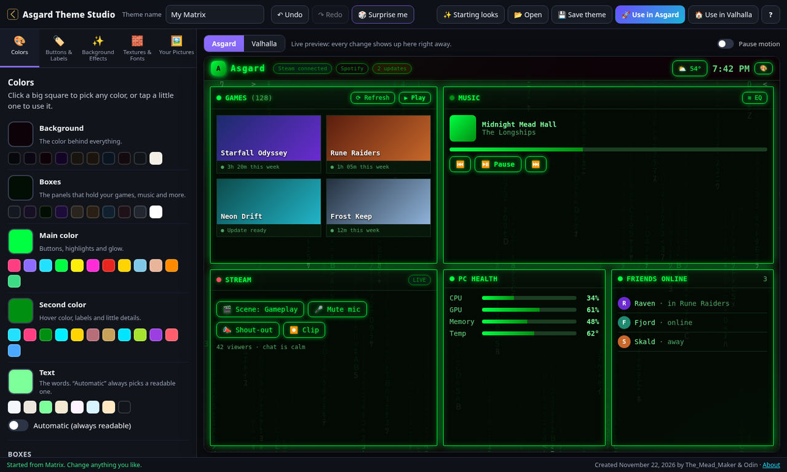
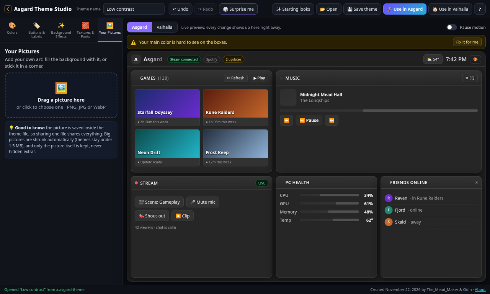
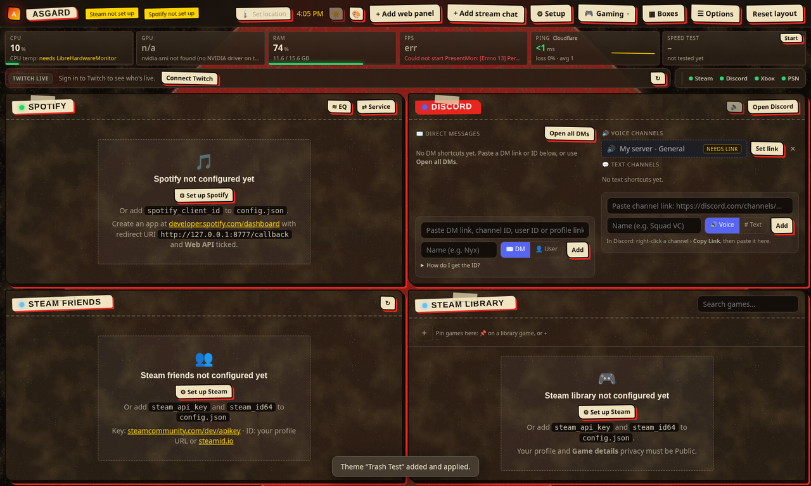

<!-- Asgard Theme Studio - Created November 22, 2026 by The_Mead_Maker & Odin. Copyright (c) 2026 The_Mead_Maker & Odin. MIT License. -->

# Asgard Theme Studio

**Make your own look for [Asgard](https://github.com/MeadCore/Asgard) and [Valhalla](https://github.com/MeadCore/Valhalla). No code, no tech skills: just point, click and drag.**

Pick a starting look, change the colors, buttons, fonts and moving backgrounds, drop in your own picture, and watch the
preview change as you go. When you like it, save it, or send it straight to Asgard with one click.

*Created November 22, 2026 by The_Mead_Maker & Odin.*

### ⬇️ [Download Asgard Theme Studio for Windows](https://github.com/MeadCore/Asgard-Theme-Studio/releases/latest)

Get **Asgard-Theme-Studio-Setup-1.0.0.exe** from the latest release, open it and follow the steps. You don't need to be an
admin, and it doesn't need the internet. Windows 10 or 11.

## What you can make

| Gachiakuta (stickers & tape) | Cyberpunk (clipped corners) | Matrix (code rain) |
|---|---|---|
|  |  |  |

There are also Dark Romance, Retro 80s, Viking and a Blank page to start from.

## How to use it

1. **Open Asgard Theme Studio** from the Start menu.
2. **Pick a starting look.** Choose whichever one is closest to what you want. You can change everything afterwards.
3. **Change things with the tabs on the left.** The preview updates right away.
   - 🎨 **Colors**: background, boxes, main color, second color and text. Click a big square to pick any color, or tap a ready-made one.
   - 🏷️ **Buttons & Labels**: plain, rounded pills, stickers & tape, clipped corners, neon glow or rose-gold edges, plus 7 logo styles.
   - ✨ **Background Effects**: matrix rain, floating embers, falling snow, scanlines or film grain. Choose how much, how fast and how bright.
   - 🧱 **Textures & Fonts**: marble, grunge, paper or carbon fiber, and fonts that come with Windows.
   - 🖼️ **Your Pictures**: drag in a PNG, JPG or WebP and use it as the background or as a sticker in a corner.
4. Use the **Asgard / Valhalla** switch above the preview to see how your theme looks in each one.
5. Made a mistake? Press **↶ Undo**. Feeling lucky? Press **🎲 Surprise me**.
6. **💾 Save theme** puts a `.asgard-theme` file in *Documents › Asgard Themes*. To share your theme, send that one
   file to a friend; it has everything in it, pictures included.

If something gets hard to read, a yellow note appears above the preview with a **Fix it for me** button.

## Putting your theme on

- **Asgard:** press **🚀 Use in Asgard**. If Asgard is open, a message pops up at the bottom of Asgard: click **Add it**
  and you're done. If Asgard isn't open, the Studio saves the file and shows you the two quick steps
  (in Asgard: 🎨 button › **Import theme…**).
- **Valhalla:** press **🏠 Use in Valhalla** and follow the two steps (scene button › **Import theme…**).

> **Which versions?** Full themes (buttons, fonts, textures, pictures and every moving background) need
> **Asgard 1.3.0 or newer** and **Valhalla 2.2.0 or newer**. Those releases are coming soon. Older versions still load the
> colors (and Asgard's matrix rain) from a theme.

## Safe by design

- **Works offline.** The Studio only loads its own files and never contacts the internet.
- **Theme files can't contain code or links.** They hold only colors, choices from built-in lists and one picture, and
  every app checks them before using them. Anything else is refused with a plain-words message.
- **Pictures are re-drawn** when you add them, so only the plain picture is kept, never hidden extras. Theme files stay under 1.5 MB.
- **"Use in Asgard" only talks to Asgard on the same PC.** Websites and other devices can't send themes to your Asgard.
- The Studio opens in its own window using Brave or Google Chrome if you have them (otherwise your normal browser).
  It closes by itself about a minute after you close its window.

## Questions

**Nothing happened when I pressed Use in Asgard.** Look at the bottom of the Asgard page for the **Add it** message.
Missed it? Import the saved file from *Documents › Asgard Themes* instead.

**My picture got smaller.** Big pictures are shrunk automatically so the theme file stays small enough to share.

**Can I edit a theme someone sent me?** Yes: **📂 Open** it, change anything, then save it under a new name.

**Where is the theme file format described?** In [docs/THEME-FORMAT.md](docs/THEME-FORMAT.md).

## For tinkerers

The Studio is a small Python program (standard library only) that serves a local web page. To run it from source:
`python studio_app.py`. To build the Windows program and installer: `windows\build_exe.bat` (PyInstaller + Inno Setup 6).
Tests: `python tests/test_theme_check.py`, `node tests/test_kit.mjs`, and `tests/ui_test.py` (Playwright).

## License

MIT. Copyright (c) 2026 The_Mead_Maker & Odin. See [LICENSE](LICENSE). The rune icon and all built-in art were drawn for this project.
